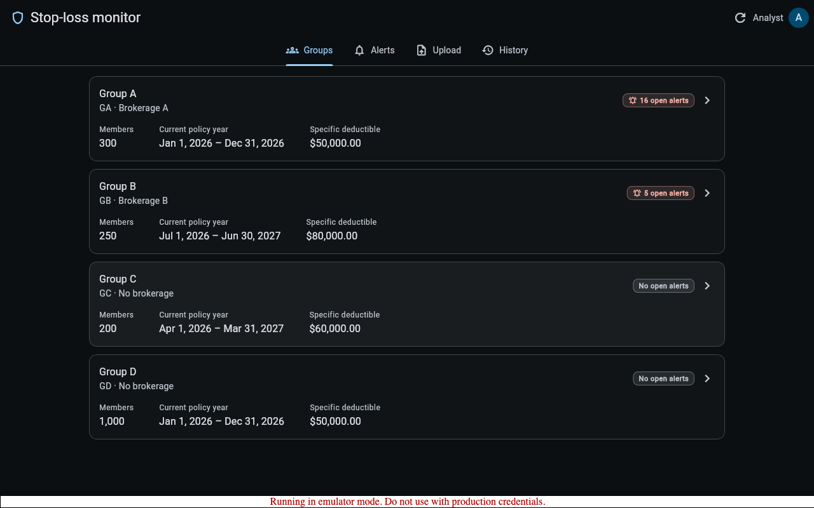
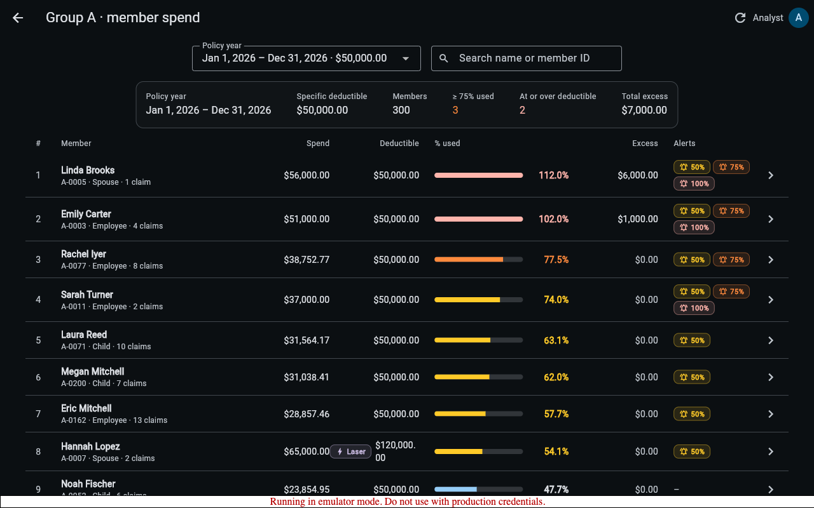
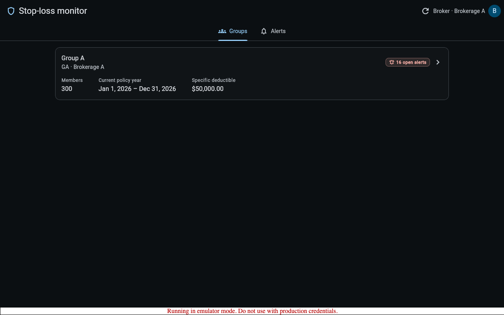

# Stop-loss claims monitor

Analysts upload monthly TPA claim files. The app keeps a running total of each member's spend per policy year,
following the claim-version rules, and raises alerts at 50 / 75 / 100 % of the member's specific deductible. Brokers
get a read-only view of their own groups.

**Stack:**
- Flutter web
- Firebase Authentication (local emulator)
- Spring Boot 4 / Java 25 API
- PostgreSQL 16 with Flyway migrations
- Docker Compose locally; Terraform for Google Cloud (Cloud Run, Cloud SQL, Firebase Hosting / Identity Platform)

| Doc | What's in it |
|---|---|
| [`DECISIONS.md`](DECISIONS.md) | Design decisions, every rule interpretation, and the shortcut list |
| [`AI.md`](AI.md) | How the AI tools were driven |
| [`PRODUCTION.md`](PRODUCTION.md) | What changes for 50 insurers / 100M claims a year |
| [`docs/SPEC.md`](docs/SPEC.md) | The API and process contract the parts were built against |

## Run it

Requirements: Docker with Compose v2, and roughly 6 GB of free disk for the images.

```bash
docker compose up --build        # first build takes a few minutes (Flutter SDK + Maven dependencies)
```

Then open **http://localhost:8081** and sign in with one of the seeded logins (the login screen fills them in for
you):

| Login | Password | Sees |
|---|---|---|
| `analyst@example.test` | `Password123!` | All groups. Can upload and acknowledge |
| `broker.a@example.test` | `Password123!` | Group A only, read-only |
| `broker.b@example.test` | `Password123!` | Group B only, read-only |

On startup the API applies the Flyway migrations, seeds groups, policy years, lasers, members and users from
[`data/`](data), and creates the three logins in the Firebase Auth emulator. **No claims are loaded**, so the upload
is yours to try:
- **In the UI:** Upload tab → select every file in `data/claims/` at once. The app uploads them one at a time, in
  file-name order, and shows each file's result: counts, failed rows with row number and reason, and alerts raised.
- **Or from the command line:** `make load-sample` (`docker compose run --rm api --app.mode=load-sample`).

| Port | Service |
|---|---|
| 8081 | Web app (nginx serves the Flutter build and proxies `/api`) |
| 8080 | API (`/healthz` is open; everything under `/api` needs a Firebase ID token) |
| 9099 / 4000 | Firebase Auth emulator / Emulator UI |
| 55433 | Postgres (`postgres`/`postgres`, database `stoploss`) |

All ports bind to 127.0.0.1. Run `docker compose down -v` to start again from an empty database. If you ran an earlier
checkout of this repo, run it once first: the database volume from the Node version of the API isn't
Flyway-compatible.

### End-to-end check

```bash
docker compose down -v && docker compose up -d --build --wait
python3 tools/e2e_check.py
```
It signs in through the emulator and uploads every sample file through the real API. It then compares each file's
counts and failed rows, every alert, and every member's spend against
[`tools/reference_model.py`](tools/reference_model.py), a separate ~150-line implementation of the rules. It also
checks that broker A can't reach Group B over HTTP, and the acknowledge flow. CI runs the same check.

### Tests

```bash
cd api && ./mvnw -B verify       # unit + integration tests (Testcontainers Postgres; needs Docker)
cd app && flutter test           # model, client, controller and widget tests
```
On colima, Testcontainers needs `DOCKER_HOST=unix://$HOME/.colima/default/docker.sock` and
`TESTCONTAINERS_DOCKER_SOCKET_OVERRIDE=/var/run/docker.sock` (see [`api/README.md`](api/README.md)).

## Architecture

```
 Browser: Flutter web app
   │ (1) email/password sign-in ──────────────► Firebase Auth
   │                                             (local: emulator :9099 · prod: Identity Platform)
   │ (2) /api/*  Authorization: Bearer <Firebase ID token>
   ▼
 nginx :8081 (local)  /  Firebase Hosting rewrite /api/** (prod)    same origin, so no CORS
   ▼
 Spring Boot API :8080 (local container  /  Cloud Run in prod)
   • verifies the ID token (firebase-admin) → email → app_user row → role + brokerage   (DB is the source of truth)
   • broker scoping in SQL: every group-scoped query joins a visible_group CTE; other groups → 404
   • upload = one transaction + per-group advisory lock:
       parse (layout from header) → validate rows → version decision per row (new / older / unchanged / conflict)
       → store every version → recompute claim_current → spend per touched (member, policy year)
       → alerts at 50/75/100 % (unique per member/year/threshold)
   ▼
 PostgreSQL 16 (container  /  Cloud SQL), schema via Flyway
   employer_group · policy_year · member · laser · brokerage · app_user
   upload · upload_row_error · claim_version (every version) · claim_current (one row per claim) · alert
```

Repository layout: `api/` Spring Boot API · `app/` Flutter app · `infra/` (Terraform, emulator image, nginx) ·
`.github/workflows/` CI + manual deploy · `tools/` reference model + end-to-end checker · `data/` sample data.

## What works

Core, mapped to the brief:

1. **Two roles.**
   - Analyst and broker logins via Firebase Auth. Role and brokerage come from the database.
   - Brokers see only their own groups. **The API enforces this in SQL:** another brokerage's group, member or alert
     returns 404, and broker writes return 403. Tested at unit, integration and HTTP level.
2. **Claim file upload, both layouts.**
   - Layout is detected from the header, so files from new groups and reordered columns work.
   - Failed rows are shown with row number and reason: unknown member, member of another group, bad amount or date,
     unknown status, same-version conflict.
   - Summary rows are skipped.
   - **Re-uploading a file changes nothing** (every row is "unchanged").
3. **Spend per member per policy year**, following the version rules: the newest version wins, a reversal or void
   pays $0, a late older version changes nothing, a same version with different values is an error. Policy year is
   by service date. Lasers replace the group's deductible. Shows % used and excess.
4. **Alerts at 50/75/100 %.**
   - Checked after each file; one file can raise several.
   - At most once per member, policy year and threshold, even if spend drops and rises again.
   - Analysts see open alerts newest first and acknowledge them with a required note.
5. **Relational database with migrations:** PostgreSQL + Flyway.
6. **Tests:** claim-version rules, alert rules, parsing, and access control (broker A can't see Group B). There's
   also a golden test over all sample files, the Flutter widget tests, and the end-to-end check.
7. **`docker compose up`** runs everything, with seed data and the three logins.
8. **CI** ([`.github/workflows/ci.yml`](.github/workflows/ci.yml)):
   - API build and tests
   - Flutter analyze, test and build
   - full compose stack plus the end-to-end check
   - `terraform validate`
9. **Infrastructure as code** ([`infra/terraform/`](infra/terraform)): Cloud Run, Cloud SQL, Secret Manager,
   Artifact Registry, Firebase Hosting and Identity Platform, with Workload Identity Federation for GitHub Actions.
   It has been validated but not applied, as the brief asks; its README explains it.

Optional extras done:
- **Member drill-down:** every claim and every version behind a member's spend, with the file and row each came
  from.
- **Safe concurrent uploads:** a per-group advisory lock, covered by a test.
- **Audit basics:** who uploaded which file (with sha256), and who acknowledged which alert, when, and with what note.

Not done, and other simplifications: see the **shortcut list in [`DECISIONS.md`](DECISIONS.md#shortcut-list)**.
Notably, uploads are synchronous, there's no pagination, and the TPA layouts are in code. Also, **no real Firebase
project exists**: creation hit the GCP project quota, so prod config is placeholders and everything runs on the
emulator.

## Screenshots

| Groups (analyst) | Group A member spend (analyst) | Broker A: only Group A, read-only tabs |
|---|---|---|
|  |  |  |
